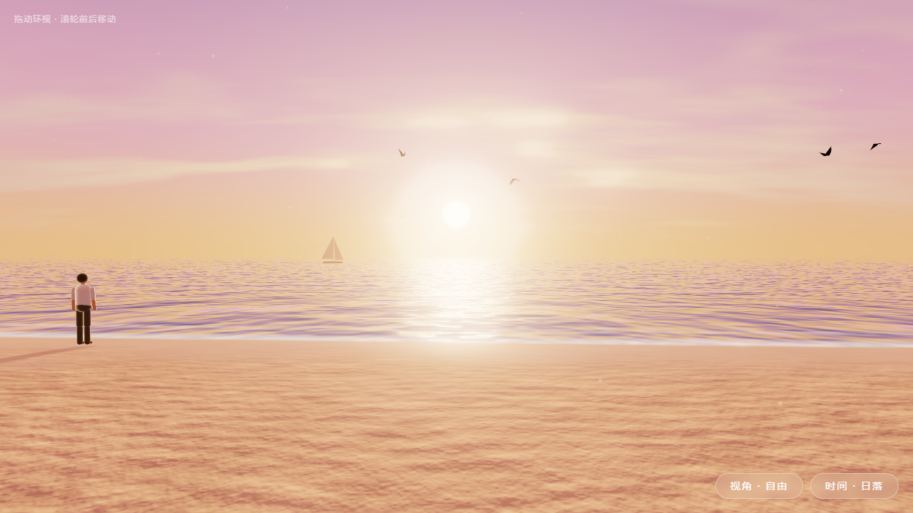
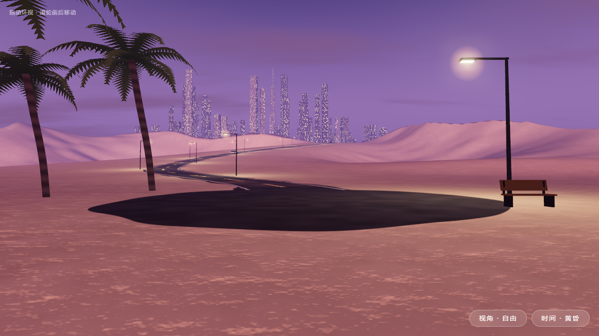
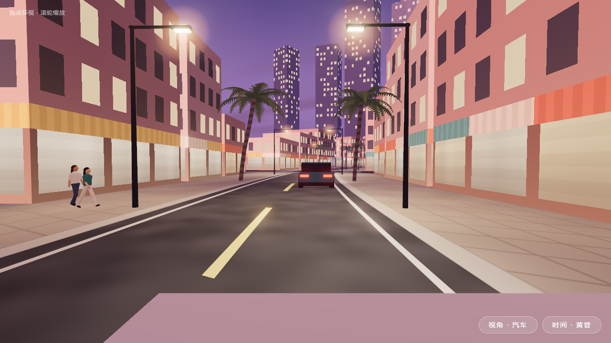
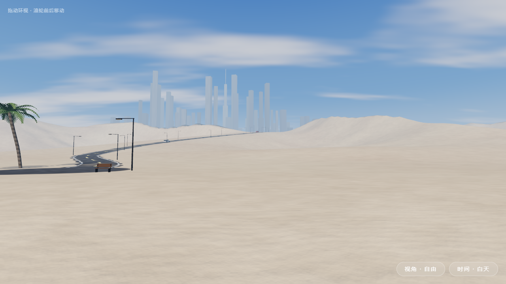

# 海边日落 · Sunset Beach

一个用 Three.js 写成的单文件 3D 场景：夕阳下的海滩、身后蜿蜒穿过沙漠的公路，以及远处若隐若现的城市。

| 黄昏 · 从海边回望公路与城市 | 黄昏 · 驾车驶入城市 |
| :---: | :---: |
|  |  |

| 白天 · 沙漠与远处的天际线 |
| :---: |
|  |

## 场景内容

- **海与天空**：渐变天空和丝状云，低悬的太阳在海面上拉出一条金色反光带。海鸥飞过，空中有漂浮的光点，一艘小帆船慢慢横过海面。
- **沙滩**：几位散步的人，包括一对牵手的情侣、一个遛狗的人、一位带着拿气球孩子的妈妈，还有一个独自站在水边看日落的人。沙滩上有朝海倾斜的棕榈树，公路尽头的回车场边有一盏孤灯和一张朝海的长椅。
- **沙漠公路**：公路从海边出发，蜿蜒爬过沙丘通向城市，每 30 米一盏路灯，傍晚依次亮起。5 辆汽车在路上往返行驶，日落后亮起车灯。
- **城市**：进城后是铺装街道，有人行道、斑马线和棕榈林荫道。沿街小楼一楼是橱窗和彩色遮阳棚，人行道上有行人。街道尽头是一个环岛和一座地标塔。
- **时间变化**：白天、日落、黄昏三个时段之间平滑过渡。黄昏时太阳沉入海平面以下，星星出现，楼窗和路灯亮起。

## 操作

| 操作 | 效果 |
| --- | --- |
| 拖动（鼠标或单指） | 环视：水平可转一整圈，上下接近垂直 |
| 滚轮 / 双指捏合 | 自由视角下沿视线前后移动；行人和汽车视角下缩放 |
| 右下角「视角」按钮 | **自由** → **行人**（以遛狗人的视角沿海岸散步）→ **汽车**（坐在车里沿公路开进城市） |
| 右下角「时间」按钮 | 白天 → 日落 → 黄昏 |

在自由视角下，停止操作 6 秒后镜头会开始缓慢自动环视。

## 运行

不需要安装或构建，用浏览器直接打开 `index.html` 即可。

- 打开时需要联网，Three.js 从 jsDelivr CDN 加载。
- 浏览器需要支持 WebGL 2，较新版本的 Chrome、Edge、Firefox 和 Safari 都可以。

## 技术说明

- **Three.js r160**，所有代码都在一个 HTML 文件里。
- **自写着色器**：海面、天空、沙滩和沙丘都用自写的着色器绘制，没有使用 Three.js 自带的 Water 和 Sky。
- **后期处理**：UnrealBloomPass 泛光，ACES Filmic 色调映射，后期缓冲区开启 4 倍多重采样抗锯齿。
- **自动降分辨率**：帧率连续 2.5 秒低于 30 时自动降低渲染分辨率。只降不升，避免画面反复跳动。
